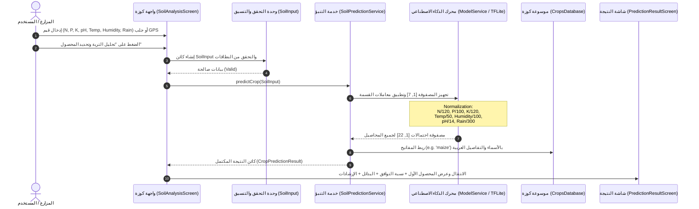

# المعمارية الفنية وتدفق البيانات — تطبيق كــــوزة (Kooza Architecture)

وثيقة معمارية البرمجيات لنظام كوزة، توضح تدفق البيانات من مدخلات المزارع وحتى التنبؤ بنموذج التعلم الآلي وعرض التوصيات الزراعية.

---

## 1. مخطط تدفق البيانات (End-to-End Data Flow)

---

## 2. الفصل المعماري بين التعلم الآلي (ML) والمساعد الذكي (Conversational AI)

> [!IMPORTANT]
> **قاعدة الفصل الهندسي:** تم الفصل الكامل بين نظامين ذكيين مستقلين في التطبيق:

1. **نظام توصية المحاصيل (Crop Recommendation ML Model):**
   - **النوع:** نموذج تعلم آلي مصنف (Multi-class Classifier) بصيغة `.tflite`.
   - **المهمة:** حساب احتمالية نجاح كل محصول بناءً على خصائص التربة الكيميائية والفيزيائية والمناخية فقط.
   - **الموقع:** يعمل محلياً بالكامل 100% Offline داخل تطبيق الهاتف.

2. **المساعد الزراعي التفاعلي (Conversational AI Assistant - Ask Kooza):**
   - **النوع:** محرك إجابات واستشارات زراعية تفاعلية.
   - **المهمة:** الرد على استفسارات المزارعين اللغوية حول طرق الري، التسميد، مواعيد الزراعة، والتعامل مع الآفات بلهجة مصرية ودودة.

---

## 3. طبقات البرمجيات (Software Layering)

1. **طبقة الواجهات (Presentation Layer):**
   - `screens/` و `widgets/` معتمدة على مبادئ Clean UI ومتحكمة في الحالة عبر `StatefulWidget` المنظم وتدفق المعطيات الصريح.
2. **طبقة النطاق والبيانات (Data & Domain Layer):**
   - `models/`: تمثيل DTOs مثل `SoilInput` و `CropPredictionResult` و `CropInfo`.
   - `static_data/`: قواعد بيانات زراعية ثابتة موثوقة (`CropsDatabase`, `FarmingTipsDatabase`).
3. **طبقة الخدمات والبنية التحتية (Services & Infrastructure Layer):**
   - `SoilPredictionService` الملتزم بنموذج TFLite دون تعديل.
   - `WeatherService` للاستعلام عن GPS والطقس.
   - `AiAssistantService` لإدارة الحوار الزراعي.
   - `PlantDiseaseService` لفحص الصور عبر API.
